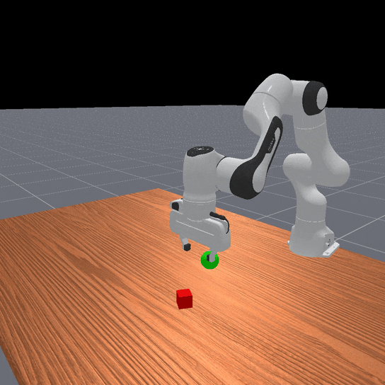
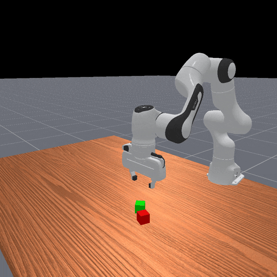
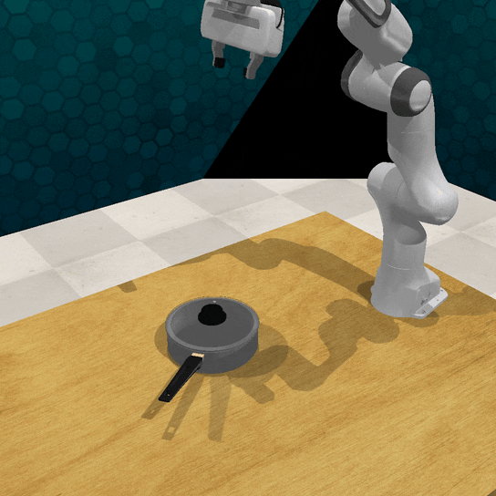
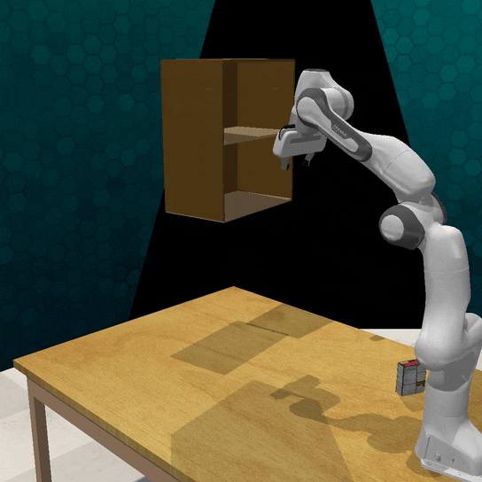

# LLM-TALE: LLM-Guided Task- and Affordance-Level Exploration in Reinforcement Learning

<p align="center">
  <a href="https://arxiv.org/abs/2509.16615"></a>
  <a href="https://llm-tale.github.io/"></a>
  <a href="https://2026.ieee-icra.org/"></a>
  <a href="https://www.python.org/downloads/release/python-3100/"></a>
</p>

Official code for the paper:

> **LLM-Guided Task- and Affordance-Level Exploration in Reinforcement Learning**<br>
> Jelle Luijkx, Runyu Ma, Zlatan Ajanović, Jens Kober — *ICRA 2026*<br>
> [[arXiv]](https://arxiv.org/abs/2509.16615) [[Project page]](https://llm-tale.github.io/)

## Overview

LLM-TALE is a framework that uses an LLM's planning to directly steer RL exploration at two levels: a **task level** (which subgoal to pursue) and an **affordance level** (how to interact with the relevant object). Unlike prior approaches that assume optimal LLM-generated plans or rewards, LLM-TALE corrects suboptimality online and explores multimodal affordance-level plans without human supervision, improving sample efficiency and success rates on robotic manipulation benchmarks and transferring zero-shot to a real robot.

## Installation

### Prerequisites: install `uv`

We advise using `uv` to install the `llm-tale` package. Please install `uv` by following the [installation instructions](https://github.com/astral-sh/uv?tab=readme-ov-file#installation) if you don't have it yet.

### Prerequisites: set up RLBench (not required for ManiSkill tasks)

Install CoppeliaSim:

```bash
# set env variables
export COPPELIASIM_ROOT=${HOME}/CoppeliaSim
export LD_LIBRARY_PATH=$LD_LIBRARY_PATH:$COPPELIASIM_ROOT
export QT_QPA_PLATFORM_PLUGIN_PATH=$COPPELIASIM_ROOT

wget https://downloads.coppeliarobotics.com/V4_1_0/CoppeliaSim_Edu_V4_1_0_Ubuntu20_04.tar.xz
mkdir -p $COPPELIASIM_ROOT && tar -xf CoppeliaSim_Edu_V4_1_0_Ubuntu20_04.tar.xz -C $COPPELIASIM_ROOT --strip-components 1
rm -rf CoppeliaSim_Edu_V4_1_0_Ubuntu20_04.tar.xz
```

Make sure the environment variables above are set whenever you run RLBench experiments, and verify you can run RLBench headless by following [these instructions](https://github.com/stepjam/RLBench?tab=readme-ov-file#running-headless).

### Install `llm-tale`

Clone the repository:

```bash
git clone git@github.com:llm-tale/llm_tale.git
cd llm_tale
```

Create and activate the virtual environment:

```bash
uv venv --python 3.10
source .venv/bin/activate
```

Install the package:

```bash
uv pip install -e .
```

### Verify the installation

```bash
pytest tests/test_tasks.py
```

## Tasks

**ManiSkill** (PickCube, StackCube, PegInsert):

<p align="center">
  
  
  
</p>

**RLBench** (TakeLid, OpenDrawer, PutBox):

<p align="center">
  
  
  
</p>

Additional videos, including real-robot rollouts, are available on the [project page](https://llm-tale.github.io/).

## Reproducing the results

Run the LLM-BC baseline:

```bash
bash scripts/run_llm_bc.sh
```

Run LLM-TALE:

```bash
bash scripts/run_llm_tale.sh
```

## LLM code generation

To generate or inspect the code produced by the LLM, see the `code_generation` notebook under `notebooks/`.

## Citation

If you find this work useful, please consider citing:

```bibtex
@inproceedings{luijkx2026llmtale,
  title     = {{LLM}-Guided Task- and Affordance-Level Exploration in Reinforcement Learning},
  author    = {Luijkx, Jelle and Ma, Runyu and Ajanovi{\'c}, Zlatan and Kober, Jens},
  booktitle = {IEEE International Conference on Robotics and Automation (ICRA)},
  year      = {2026}
}
```

## Acknowledgements

For the prompt structure, we took inspiration from [DROC](https://github.com/Stanford-ILIAD/droc). Our TD3 and PPO agents are based on the [SKRL examples](https://skrl.readthedocs.io/en/latest/intro/examples.html).
